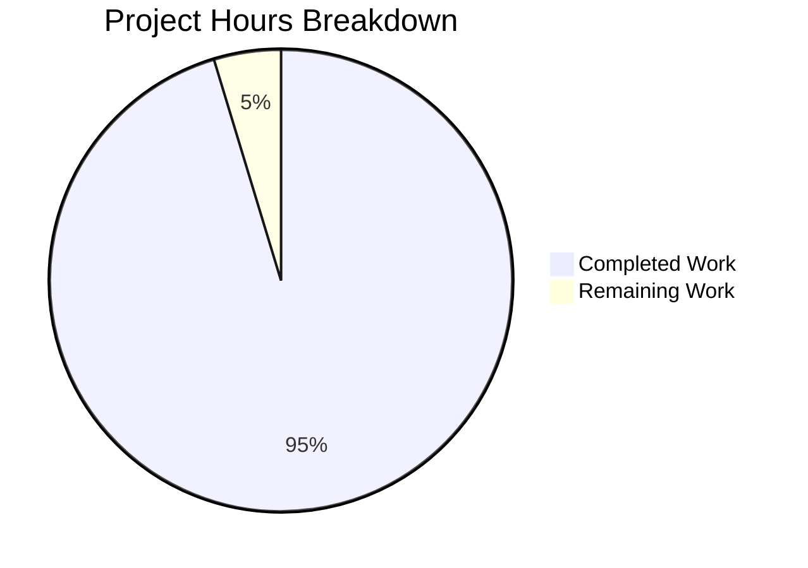

# 1. Executive Summary

## 1.1 Project Overview

Foundry is an installable Python test-automation framework — distribution `pytest-foundry`, import package `foundry`, version `0.1.0` — that gives an existing pytest suite layered configuration, HTTP/API helpers, JSON Schema contracts, data-driven cases, record/replay, retries with quarantine, sharding, artifact capture and an offline HTML report without writing that plumbing. Four surfaces in one distribution: a self-activating pytest plugin, a twelve-fixture library, the `foundry` console application with five subcommands, and a scaffolder that runs green offline. CPython 3.11–3.13 on Linux and macOS; no server, daemon or network dependency.

## 1.2 Completion Status

**95.3 % complete — 1,466 of 1,538 hours delivered, 72 hours remaining.**



| Metric | Value |
|---|---|
| Total Hours | 1,538 |
| Completed Hours (Baseline: Human with agentic-assist) | 1,466 |
| Remaining Hours | 72 |
| Percent Complete | 95.3 % |

Calculation: 1,466 ÷ (1,466 + 72) × 100 = 95.3 %. Hours cover only the 35 scoped requirements and the path to production: every completed hour traces to a component in Section 2.1, every remaining hour to an open item in Section 1.4.

## 1.3 Key Accomplishments

- [x] Plugin activates on installation alone: banner, `foundry_` marker namespace, 31 `--foundry-*` spellings, run id and artifact root.
- [x] Four-layer configuration over 28 keys with per-key source attribution and closest-key/range diagnostics.
- [x] Twelve public fixtures on their documented scopes, from `foundry_config` to `foundry_api`, `foundry_db` and `foundry_poll`.
- [x] Synchronous HTTP client: four auth strategies, four retry predicates with clamped backoff, non-2xx returned not raised.
- [x] Record/replay opening zero sockets, masking secrets at capture, reporting a typed miss that names the cassette.
- [x] In-framework retries, quarantine in `report` and `strict` modes, per-test timeouts, shard-independent collection.
- [x] `results.json`, `junit.xml` and a self-contained `report.html`, plus artifact bundles and `foundry report compare`.
- [x] 1,036 tests and a 24-test example green live and in replay at 90.49 % coverage, every gate inside budget.

## 1.4 Critical Unresolved Issues

Seven of the 35 scoped requirements carry an open item; together they account for the 72 hours remaining.

| Issue | Impact | Owner | ETA |
|---|---|---|---|
| Platform claim unverified beyond Linux on CPython 3.13.18: macOS and CPython 3.11/3.12 never executed | A supported-platform claim that has not been observed | Repository owner | 40 h |
| Redaction is name- and shape-driven, so a credential typed into a plain literal can reach `traceback.txt` | Needs an agreed handling convention and a recorded sign-off | Security owner | 8 h |
| An all-deselected run exits 5, not the 4 the state table names, because pytest's own code is preserved | A CI rule written against 4 misreads the run | Maintainer | 4 h |
| The added runtime dependency `referencing` awaits governance approval | Manifest differs from the published list until approved | Dependency owner | 3 h |
| `http.base_url` and `http.headers` reject values the published prose would accept (userinfo, control characters) | Callers migrating in may be surprised | Maintainer | 3 h |
| A failure-heavy report (~11.4 MB at 500 failing records with 200-line log tails) never rendered in a browser at that size | Latency exactly when a team needs the report most | Maintainer | 6 h |
| The pinned pytest 8.4.2 sits inside the affected range of GHSA-6w46-j5rx-g56g (CVE-2025-71176); the suite mitigates with a private temporary root, the consumer disposition is undecided | Consumers inherit the pin unchecked | Dependency owner | 8 h |

## 1.5 Access Issues

| System/Resource | Type of Access | Issue Description | Resolution Status | Owner |
|---|---|---|---|---|
| macOS host | Build and test runner | No macOS machine is available to this delivery, so the supported macOS target cannot be exercised | Open | Repository owner |
| CPython 3.11 and 3.12 interpreters | Runtime | Only CPython 3.13.18 is provisioned; `requires-python` admits 3.11 and 3.12 | Open | Repository owner |
| Package index publication | Release credentials | The wheel and sdist build and install offline but are not published, so consumers cannot yet install `pytest-foundry` by name | Not requested | Repository owner |

## 1.6 Recommended Next Steps

1. [High] Exercise the suite, the example project and a scaffolded project on CPython 3.11 and 3.12, then on macOS (36 h).
2. [High] Record the redaction decision: keep the name/shape engine as contract, document that credentials belong in `http.auth.*_env` variables (8 h).
3. [Medium] Settle the deselected-run exit code in README and release notes and dispose of the pytest advisory (12 h).
4. [Medium] Obtain governance approval for `referencing`; verify a 500-failure report in a browser and document `logging.capture_lines` (9 h).
5. [Low] Reconcile platform statement, classifiers and accepted-key notes with what was exercised (7 h).

# 2. Project Hours Breakdown

## 2.1 Completed Work Detail

| Component | Hours | Description |
|---|---|---|
| Packaging and project manifest | 20 | `pyproject.toml` with both entry points, dependency pins, wheel/sdist selection and tool configuration; committed `uv.lock`; MIT `LICENSE`, `README.md`, `CHANGELOG.md`, root-anchored `.gitignore`; wheel and sdist built and installed offline |
| Core foundation | 40 | Eight exception types with typed attributes, shared types and enums, nodeid sanitisation and traversal containment, run-id and stable case-id generation |
| Observability and redaction | 90 | `foundry` logger with `NullHandler`, bounded log ring, the single redaction engine, artifact writer, manifest with digests, structured lifecycle events |
| Configuration layer | 150 | 14 modules: models with `extra="forbid"`, four-layer merge, per-key source attribution, five-step file discovery, profiles, environment source, CLI layer, registry of 28 keys, validation, error builders, table and JSON/TOML rendering |
| Plugin adapter | 90 | `plugin.py`: option group, marker registration, `pytest_generate_tests` data delegation, retest driver, makereport stamping, controller assembly, terminal summary, session finish, deferred xdist and pytest-timeout bridges |
| Fixture library | 60 | The twelve public fixtures with their documented scopes and contracts, plus the registration module |
| HTTP client | 95 | `FoundrySession` and `FoundryResponse`, URL resolution and origin containment, four auth strategies, retry engine with clamped exponential backoff, live transport, request/response dumps |
| Assertion helpers | 30 | `assert_status`, `assert_json_subset`, `assert_json_schema`, `eventually` with injectable sleep and clock |
| Contract validation | 40 | Schema loading, instance validation, deterministic first-violation ordering rendered with its JSON path |
| Record/replay | 65 | Cassette document model, store with redaction at capture, order-insensitive query and body-hash matcher, four modes, replay transport that never reaches the network stack |
| Data engine | 75 | CSV, JSON, YAML and JSONL loaders, document classification, matrix cross-product with sorted axes, stable case ids, schema enforcement, case-set and parametrisation adapters |
| Database fixtures | 25 | In-memory sqlite engine per test, schema creation from declarative models, transactional session rolled back at teardown |
| Execution features | 110 | Attempt coordinator, retry ledger, quarantine registry with both modes, sharding service with worker-loss detection, timeout policy on the pytest-timeout seam, typed stash keys and the cross-worker payload codec |
| Reporting | 115 | Frozen result records, JSON store, JUnit writer with properties and artifact references, self-contained HTML renderer with inlined assets and panels, comparator, renderer registry, template |
| Diagnostics and doctor probes | 35 | Interpreter, plugin-load, configuration, artifact-writability, cassette-state and socket-guard probes with table and JSON output |
| CLI and scaffolder | 95 | Click group with `run`, `init`, `config show`, `config validate`, `report compare` and `doctor`; rich rendering; exit-code mapping; both scaffold template sets |
| Self-test suite | 230 | 77 modules and 1,036 tests across unit, integration, plugin (`pytester`) and end-to-end (`subprocess`), including the layering, exception-boundary, sleep-policy, unsafe-parsing and no-dash-p guards and the timing, coverage and determinism instruments |
| Example project | 45 | The 24-test `examples/checkout` suite with loopback echo server, socket guard, deterministic work helper, test data and seven committed cassettes |
| Verification scripts | 16 | `scripts/verify.sh` (six gates in fixed order, first-failure exit) and `scripts/count_lines.sh` (five size rows plus the per-file ceiling) |
| Documentation | 40 | `README.md` walkthrough and reference, `CHANGELOG.md`, `docs/verification.md` with per-dependency provenance and the added-dependency log, and the public docstrings the type and lint gates require |
| **Total** | **1,466** | Equals Completed Hours in Section 1.2 |

## 2.2 Remaining Work Detail

| Category | Hours | Priority |
|---|---|---|
| CPython 3.11 and 3.12 interpreter-matrix run of the suite, example project and a scaffolded project, with fixes | 20 | High |
| macOS validation run of the same three surfaces, with POSIX-difference fixes | 16 | High |
| Redaction boundary: record the security decision and the credential-handling convention for secrets typed into literals | 8 | High |
| Deselected-run exit-code reconciliation across README, release notes and the state table | 4 | High |
| Platform statement, classifier and `CHANGELOG` reconciliation with what the matrix exercised | 4 | Medium |
| Dependency-governance approval and release-note entry for the added `referencing` pin | 3 | Medium |
| Disposition of the pytest advisory affecting the pinned 8.4.2 range (keep the private-temporary-root mitigation for consumers, or move the pin) | 8 | Medium |
| Browser verification of a 500-failure report and payload guidance for `logging.capture_lines` | 6 | Medium |
| Published-surface note for the narrowed `http.base_url` and `http.headers` accepted ranges | 3 | Low |
| **Total** | **72** | Equals Remaining Hours in Section 1.2 |

Estimation basis: hours are human-with-agentic-assist effort for the delivered or outstanding work, anchored on the 109 source modules (complex modules 24–40 h, simple modules 4–8 h), 31,901 source lines, 14,988 test lines, 1,036 executed tests and the four gates that must stay green. Confidence is high for the platform-matrix items (repeatable runs with a known procedure) and medium for the advisory disposition, where the choice between documenting the mitigation and moving the pin depends on an external advisory timeline.

# 3. Test Results

Every figure below is from a run performed on this tree with CPython 3.13.18: `pytest --cov=foundry --cov-fail-under=85 -n auto` (1,036 passed, 1 skipped, 86 s, coverage 90.49 %), the two example-project runs, and the browser session over the generated report.

| Area / Category | Framework | Tests | Passed | Failed | Coverage | What This Proves |
|---|---|---|---|---|---|---|
| Unit tests — `tests/unit`, 38 modules | pytest 8.4.2 | 816 (1 skipped) | 815 | 0 | 90.49 % of `src/foundry`, measured over the whole suite | Each module's contract holds in isolation: configuration ladder and validation, redaction shapes, result records, cassettes, data loaders, database, HTTP, CLI internals |
| Integration tests — `tests/integration`, 10 modules | pytest with `tmp_path` and loopback peers | 45 | 45 | 0 | included above | Real files, real configuration layers, cassette round-trip through a loopback echo server, report rendering, end-to-end redaction, and the three cost budgets |
| Plugin behaviour — `tests/plugin`, 20 modules | `pytester`, `CliRunner` and `subprocess` | 153 | 153 | 0 | included above | Activation with no flag, profile banner, documented exit codes, retries reaching `attempts: 3`, quarantine in both modes, the state-table rows, the public contract and the reachability ledger |
| End-to-end — `tests/e2e`, 8 modules | `subprocess`, fresh virtual environment | 23 | 23 | 0 | included above | Offline wheel install into a clean environment, the 24-test example, record then replay, sharding equality and wall-clock ratio, determinism, zero non-loopback sockets, `not_run` records |
| Example project, live | pytest with an in-process echo server | 24 | 24 | 0 | exercised end to end | Configuration, HTTP, contracts, data cases, sqlite, factory, clock, polling, retries, artifacts and reporting wired along the path a user actually runs; guard reported 14 loopback connections and 0 non-loopback |
| Example project, replay | committed cassettes, no server | 24 | 24 | 0 | exercised end to end | The same 24 tests green with the peer absent and `loopback=0`, so replay substitutes for the live dependency rather than merely mocking it |
| Generated report in a browser | headless Chrome over `file://` | 8 checks | 8 | 0 | not applicable | The report renders, shows every outcome word, lists the Quarantined section, links and opens both artifact dumps, makes no external request and stays usable with the script stripped |
| Static and size gates | ruff, `ruff format --check`, `mypy --strict`, `wc -l` | 109 modules and 200 files | clean | 0 | not applicable | Style, typing and size budgets hold: 31,901 source lines, 14,988 test lines, 1,999 example+script lines, 48,888 total, largest file 699 |

**Not covered.** Nothing in the following list is exercised by any test, and each should be verified by a human before release:

- **macOS** — the suite, the example project and the scaffolder have never been executed there; the platform is supported by declaration (README, classifiers) only.
- **CPython 3.11 and 3.12** — `requires-python` admits both, and every observation in this guide comes from CPython 3.13.18 alone.
- **Windows** — declared unsupported; no code path has been run there and none is intended to be.
- **Real remote services** — every HTTP exchange goes to an in-process loopback `http.server` or to a committed cassette. No TLS endpoint, proxy, redirect chain or third-party API has been contacted.
- **Live credentials** — the bearer, basic and header strategies are exercised with injected environment variables, never against a real identity provider.
- **Scale** — the largest environment measured is the 1,036-test self-suite and the 24-test example; no multi-thousand-test suite or sustained multi-worker stress run exists beyond `-n auto` and `-n 3`.
- **Failure-heavy report at production size** — a 500-failing-record report (~11.4 MB at 200-line log tails) has never been rendered in a browser.
- **pytest's exit code 3 (internal error)** — the path is preserved by the code but was not driven; the nearest exercised neighbour is the simulated worker-loss `run_error` record.

# 4. Runtime Validation & UI Verification

Runtime validation was driven through the installed console script, through plain `pytest` in throw-away projects and through a real browser over the generated report.

- ✅ **Plugin activation** — `pytest` in a directory with no configuration prints `foundry: profile=default`, a run id and the artifacts root, exits 0, and writes `results.json`, `junit.xml` and `report.html`.
- ✅ **Configuration precedence** — with `--foundry-http.timeout 1.0`, `FOUNDRY_HTTP__TIMEOUT=3.5` and `http.timeout = 2.0` the resolved value is 1.0 attributed to `cli:--foundry-http.timeout`; each layer in turn yields 3.5, 2.0 and the default 10.0; `http.timeout = -1` exits 2 naming the key, the accepted range and the file layer.
- ✅ **Console surface** — `foundry --version` prints `foundry, version 0.1.0`; `--help` lists `run`, `init`, `config`, `report` and `doctor`; `foundry doctor` in a bare directory reports 4 pass, 2 warn, 0 fail and exits 0.
- ✅ **Scaffolder** — `foundry init` produces a project that passes (1 test), `--template api` produces a replay-backed project that passes (2 tests) with no network, and a second `init` into a non-empty directory refuses with exit 2 and a `--force` hint.
- ✅ **Example project live and in replay** — 24 passed in 13.4 s with the guard reporting 14 loopback connections and 0 non-loopback, then 24 passed in 13.1 s with the echo server absent and 0 sockets opened.
- ✅ **Record/replay miss** — a replay run whose request has no recorded counterpart fails with `CassetteMissError` naming the method, path and cassette document.
- ✅ **Failure, skip and quarantine** — one mixed run recorded `failed`, `skipped`, `passed` and `quarantined_failed` with seven artifact kinds on each failure; a quarantined-only project exits 0 in `report` mode with JUnit `<skipped message="foundry: quarantined failure">` and exits 1 in `strict` mode.
- ✅ **Redaction** — a sentinel sent as an `Authorization` header appears in no produced file; `request.json` records `"authorization": "***"`.
- ✅ **Report in a browser** — the generated report renders with its run header, outcome chips, results table, Quarantined section and failure panel; both artifact links open; 3 network requests, all `file://`; zero console messages; identical rendering with the script stripped.
- ⚠ **External HTTP integration** — partial by construction: exercised against in-process loopback peers and committed cassettes only.

**Never exercised at runtime:** no macOS, CPython 3.11/3.12 or Windows interpreter ever ran the suite, the console script or the scaffolder; no TLS endpoint, proxy, redirect chain or third-party API was contacted, so certificate validation, proxy configuration and real-world redirect behaviour remain unverified; the four auth strategies never met a live identity provider; and nothing larger than the 1,036-test self-suite was executed, so sharding and report rendering were never observed at production scale.

# 5. Compliance & Quality Review

## 5.1 Compliance Matrix

This project carries no user-supplied rule document, so the binding benchmarks are the technical specification's own quality, security and budget requirements.

| Deliverable | Benchmark | Verified Status | Progress |
|---|---|---|---|
| Configuration layer | Typed validation, four-layer precedence, per-key attribution, actionable diagnostics (spec §0.4.5) | Pass — the ladder resolves 1.0 / 3.5 / 2.0 / 10.0 in turn and range faults exit 2 naming key, range and layer | 100 % |
| Plugin activation and session wiring | Zero-configuration activation, run id, artifacts root, profile banner (spec §0.4.2) | Pass — banner, run id and artifacts root observed with no flag and no configuration file | 100 % |
| Twelve public fixtures | Documented names, scopes and contracts (spec §0.4.3) | Pass — all twelve resolve with the documented session or function scope | 100 % |
| HTTP client, auth and retries | Non-2xx returned not raised, four predicates, clamped backoff, secret indirection (spec §0.7.3) | Pass — request pipeline and retry records verified, credentials resolved from variable names only | 100 % |
| Contract validation | Deterministic first violation carrying its JSON path (spec §0.7.1) | Pass — ordering is shallowest-path then path then message | 100 % |
| Data-driven cases | Four formats, stable ids, located collection errors (spec §0.7.2) | Pass — case ids stable across collections, faults name file, line and column | 100 % |
| Record/replay | Zero sockets on replay, order-insensitive matching, typed miss (spec §0.4.6) | Pass — replay green with `loopback=0`, miss names method, path and cassette | 100 % |
| Execution features | Retries, quarantine in both modes, timeouts, shard equality (spec §0.4.7) | Pass, with the deselected-run exit code documented at divergence D2 | 95 % |
| Reporting and artifacts | Self-contained deterministic report, JUnit enrichment, redaction at every sink (spec §0.4.6) | Pass — no external reference in the rendered file, determinism instrument green, 7 artifact kinds per failure | 100 % |
| Security controls | No secret reaches a file, terminal or report; safe parsing; path containment (spec §0.3.2, §0.14.3) | Pass within the documented name-driven boundary at divergence D9 | 90 % |
| Quality gates and budgets | Six gates green inside their numeric bands (spec §0.14.2, §0.14.4) | Pass — `scripts/verify.sh` exit 0; coverage 90.49 %; all five size rows in band | 100 % |
| Platform and provenance claims | Declared platforms exercised; every dependency justified (spec §0.4.1, §0.5.2) | Partial — Linux on CPython 3.13.18 only; the added dependency is justified in `docs/verification.md` but awaits approval | 70 % |

## 5.2 AAP & Rule Divergences and Gaps

No user rule document exists for this project, so every row below is a departure from the technical specification. Two of them — D3, the added dependency, and D4, the additive record keys — pass through mechanisms the specification itself defines, and are recorded for completeness rather than as defects.

| Ref | What the AAP/Rule Required | What Was Delivered Instead | Why It Diverged | Impact | Remediation |
|---|---|---|---|---|---|
| D1 | `foundry.contract` may import `core` alone (spec §0.4.8 import table) | `foundry.contract` imports `foundry.obs.redaction` inside functions (`contract/violations.py`) | §0.14.3 requires one redaction engine at every sink and §0.3.2 grants the capability tier `obs`; the never-import column does not name it | One sanctioned exception, pinned at `tests/unit/test_layering.py:52`; no behavioural effect | None; a future specification should add `obs` to that column |
| D2 | An all-deselected run exits 4 (spec §0.4.7 row 12) | The run keeps pytest's own exit code 5 and writes no report file | §0.4.4 states pytest's 3/4/5 are never rewritten, which outranks the row's literal number | A CI rule written against 4 misreads the run | README and release-note sentence, and a task of 4 h |
| D3 | Fourteen runtime dependencies, closed list (spec §0.5.1) | Fifteen: `referencing>=0.28.4,<0.38` added | §0.5.1 admits a justified addition recorded in `docs/verification.md`, where the row and dated log entry exist; `jsonschema` raises `referencing.exceptions.Unresolvable` | One extra MIT package; the manifest differs from the published list until approved | Owner approval, 3 h |
| D4 | Result records carry the field set of spec §0.4.6 | Records add `artifacts_disabled`, and a failure may add an `http_attempts` list | §0.4.7 requires the first field and §0.4.9 permits adding keys | Consumers that ignore unknown keys are unaffected | None |
| D5 | No environment variables written at runtime (spec §0.4.8 state table) | `examples/checkout/conftest.py` sets `FOUNDRY_EXECUTION__RETRIES` and a demo credential at import | The retry budget must exist before `pytest_configure` resolves configuration, and criterion 3 requires a flag-free example run that really retries | Confined to the example project, never the framework | None |
| D6 | `http.base_url` accepts any absolute `http`/`https` URL; `http.headers` accepts any name and value (spec §0.4.5) | Userinfo in the URL and control characters in header names or values are rejected with exit 2 | §0.4.7 and §0.14.3 require credential-leak and control-character controls | A value the prose would accept is refused | Published-surface note, 3 h |
| D7 | Public functions carry a docstring stating their contract (spec §0.13.1) | Test functions and helpers carry none; the module docstring states what each module proves | §0.14.2's hard test-line budget, and `pyproject.toml` exempts `tests/**` from the D rules | Test intent lives in module docstrings and test names | None |
| D8 | `foundry.execution.state` imports only `core` and `obs` (spec §0.4.8) | It keeps type-only imports of `foundry.config.models` and execution siblings | They type the published stash keys, and §0.4.8's normative table permits `execution → config` | None at import time | None |
| D9 | No secret reaches a file, the terminal or a report (spec §0.3.2, §0.14.3) | The engine matches names and credential shapes, so a secret typed into a plain literal is not masked; YAML `exc.problem` may echo one token | The specification fixes a deny-list engine and sets out no value-substitution pass | A credential embedded in source can reach `traceback.txt` | Security sign-off and convention, 8 h |
| D10 | Importing a module performs no I/O (spec §0.4.8) | `foundry/__init__.py` reads the distribution version at import | §0.4.1 requires exactly that read, with a literal fallback | One cached metadata lookup; the startup budget still passes at 122.5 ms of 150 ms | None |
| D11 | One unit module per package (spec §0.10.1 file plan) | Several packages split their unit tests across sibling modules (`test_config_files.py`, `test_config_constants.py`, `test_config_model.py`, …) | §0.14.2's 700-line-per-file ceiling cannot hold otherwise | File inventory differs from the plan; no behaviour untested | None |

**Divergences that need a human decision.**

*D9 — redaction boundary.* The engine recognises a secret by the name it is stored under or by a credential-like shape, which is what the specification fixes: configuration holds the *name* of a credential variable, never its value. The consequence is that a value written literally into a test — `assert token == "s3cr3t"`, or a header literal in a call — survives into `traceback.txt`, because nothing names it as a secret. The sentinel checks in `tests/integration/test_redaction_end_to_end.py` and `tests/unit/test_obs.py` pin the boundary as delivered. Deciding to accept it, or to commission a value-substitution engine, is the security owner's call; the interim convention belongs in the README.

*D2 — deselected-run exit code.* `src/foundry/plugin.py` preserves pytest's own code rather than rewriting it, which §0.4.4 requires in as many words; pytest 8.4.2 answers 5 for a run whose only items were deselected. The row's "4" is unsatisfiable alongside that rule, and the row's other half — writing no report file — is honoured. A consumer who branches on 4 will treat the run as a usage error. One sentence in `README.md` and the release notes closes it; no code change is warranted.

*D3 — added dependency.* `foundry.contract.validate` catches `referencing.exceptions.Unresolvable`, the public type `jsonschema` 4.26 raises for an unresolvable `$ref`. Naming the package makes the import honest rather than borrowing it transitively, and `docs/verification.md` carries both the table row and the dated log entry the specification names as the admission mechanism. The pin's bounds track `jsonschema`'s own requirement. Until the dependency owner approves the row, the manifest and the published inventory disagree, which matters to anyone auditing licences.

*D6 — narrowed accepted ranges.* Two configuration keys refuse values the specification's summary column would allow: a base URL carrying userinfo, and a header name or value carrying control characters. Both refusals are what the secret-leak and control-character controls require, and both fail loudly with exit 2 rather than silently. The accepted table in `README.md` already states the narrower rule, so the remaining work is a release note that says the published prose in the specification is the looser of the two.

# 6. Risk Assessment

| Risk | Category | Severity | Probability | Mitigation | Status |
|---|---|---|---|---|---|
| Support for macOS and CPython 3.11/3.12 is declared but never exercised | Technical / Operational | Medium | Medium | Run the suite, the example project and a scaffolded project on each target before announcing support; keep the README statement precise until then | Open |
| Code-size headroom is 99 source lines (31,901 of 32,000) and 12 test lines (14,988 of 15,000) | Technical / Maintainability | Medium | High | Decide the budget before the next change: trim, or re-baseline `scripts/count_lines.sh` and the specification together | Open |
| Redaction is name- and shape-driven, so a credential typed into a literal survives into `traceback.txt` | Security | Medium | Low | Keep credentials in `http.auth.*_env` variables, document the convention, and consider a value-substitution pass if literals cannot be prohibited | Open — accepted with a recorded caveat |
| The pinned pytest 8.4.2 sits inside the affected range of GHSA-6w46-j5rx-g56g (CVE-2025-71176) | Security / Supply chain | Medium | Medium | The suite pins a private temporary root; decide whether consumers get a moved pin or a documented mitigation | Open |
| Report size scales with failure count (~11.4 MB at 500 failing records with 200-line tails) | Performance / Operational | Medium | Medium | `logging.capture_lines` is the published knob; verify a failure-heavy report in a browser and document the guidance | Open |
| Every HTTP integration is exercised against in-process loopback peers and committed cassettes | Integration | Medium | Low | Add a staging smoke run against one real TLS endpoint before relying on certificate, proxy or redirect behaviour | Open |
| The layering proof carries exactly one documented import departure | Maintainability | Low | Low | Keep the departure list and its pinning assertion in step with new import edges during review | Monitored |
| A Windows user meets a declared boundary rather than an explained failure | Operational | Low | Low | README, classifiers and the `doctor` platform probe all state POSIX-only support | Accepted |

# 7. Visual Project Status


**Remaining work by priority** — 48 h High, 21 h Medium, 3 h Low, totalling the 72 h outstanding:

| Priority | Hours | Items |
|---|---|---|
| High | 48 | Interpreter matrix on CPython 3.11 and 3.12; macOS validation; redaction sign-off; deselected-run exit-code reconciliation |
| Medium | 21 | Platform statement reconciliation; approval for the added dependency pin; disposition of the pytest advisory; failure-heavy report verification |
| Low | 3 | Published-surface note for the narrowed accepted ranges |

**Where the work sits** — the delivered hours by area, with the outstanding hours each area still carries:

| Area | Hours delivered | Hours outstanding |
|---|---|---|
| Framework source and packaging | 1,135 | 12 — redaction sign-off (8) and the deselected-run exit-code note (4) |
| Self-test suite, example project and verification gates | 291 | 54 — platform exercise (36), platform reconciliation (4), failure-heavy report verification (6), pytest advisory disposition (8) |
| Documentation | 40 | 6 — published-surface note (3) and dependency approval (3) |
| **Total** | **1,466** | **72** |

# 8. Summary & Recommendations

Foundry is delivered as a working distribution rather than a scaffold. The package builds (`pytest_foundry-0.1.0-py3-none-any.whl` and sdist), installs offline into a clean environment, activates as a pytest plugin on installation alone, and offers the four surfaces the specification describes: a self-activating plugin, twelve fixtures, a five-subcommand console application, and a scaffolder whose output passes on its own. The source is 109 modules and 31,901 lines across fifteen packages plus the hook module; the self-test suite is 77 modules and 14,988 lines holding 1,036 executed tests, and the example project is exactly 24 tests with seven committed cassettes. Every gate is green on this tree: coverage 90.49 %, `ruff` and `mypy --strict` clean over 109 modules, all five code-size rows inside their bands, plugin startup 122.5 ms of a 150 ms budget, and the whole suite in 87 s of a 360 s ceiling. On the scoped definition, **1,466 of 1,538 hours are complete — 95.3 %**.

What was exercised is unusually broad for a first release. The suite drives the plugin through pytest's own machinery (`pytester`), the console script and the wheel through subprocesses and a fresh virtual environment, and the report through a real browser over `file://`. The strongest observations are behavioural rather than structural: a replay run of the 24-test example passes with the echo server absent and zero sockets opened; a sentinel credential sent as an `Authorization` header appears in no produced artefact, with `***` where the header is recorded; two consecutive runs normalise to identical `results.json` and `report.html`; and the rendered report makes no request outside the file system and renders identically with its script stripped.

Nothing in the framework's behaviour is unfinished. The 72 outstanding hours are platform verification, governance and one scale check: 36 hours to exercise macOS and CPython 3.11/3.12, 4 hours to reconcile the platform statement with what those runs show, 12 hours of decisions (the redaction boundary and the deselected-run exit code), 11 hours of dependency and advisory disposition, 6 hours to verify a failure-heavy report in a browser, and 3 hours of release-note housekeeping for two narrowed accepted ranges.

The critical path to production runs through governance first, because two of those decisions change what the project may claim: approval of the added `referencing` pin and the disposition of the pytest advisory affecting the pinned range. The interpreter matrix and the macOS run come next, with the documentation pass last. Success on that path is measurable with instruments already in the repository: `scripts/verify.sh` exits 0 on CPython 3.11, 3.12 and 3.13 and on macOS, coverage stays at or above 85 %, `pytest examples/checkout` reports 24 passed live and 24 passed in replay on each target, and `scripts/count_lines.sh` stays inside its bands.

**Production readiness.** Ready for adoption now on Linux with CPython 3.13, where every claim in this guide was observed. Ready with declared caveats on macOS and CPython 3.11/3.12, whose support is implemented but unexercised. Not yet published, so consumers must install from the built wheel. The recommendation is an internal pilot on Linux while the matrix, the security sign-off and the dependency approval close out, and a public release once they do.

# 9. Development Guide

## System Prerequisites

| Requirement | Version used here | Notes |
|---|---|---|
| Operating system | Linux (Ubuntu) | macOS is supported; Windows is not |
| CPython | 3.13.18 | `requires-python = ">=3.11,<3.14"`; 3.11 and 3.12 are supported but not yet exercised |
| `uv` | 0.13.10 | Environment and build tool; no separate editable-install step is needed |
| `git` with `git-lfs` | 3.7.1 | The repository's hooks run `git lfs` on checkout, commit and merge |
| External services | none | sqlite is in memory per test; every HTTP peer is a loopback server or a committed cassette; no port is fixed |

## Environment Setup

From the repository root:

```bash
# Create .venv from the committed lock file and install the dev extras (~20 s with a warm cache)
uv sync --extra dev --frozen

# Put pytest, foundry, ruff and mypy on PATH for this shell
export PATH="$PWD/.venv/bin:$PATH"

# Confirm the interpreter the project expects
python -V            # Python 3.13.18
```

`uv sync` reads `pyproject.toml` and `uv.lock` and resolves nothing from an index when the local cache is populated, so setup works offline. `.venv/` is git-ignored, so every clone creates its own.

## Build and Test

```bash
# Wheel and sdist
uv build
ls dist/             # pytest_foundry-0.1.0-py3-none-any.whl  pytest_foundry-0.1.0.tar.gz

# Whole suite with the coverage gate
pytest --cov=foundry --cov-fail-under=85 -n auto
# 1036 passed, 1 skipped, coverage 90.49 %, ~86 s

# The single gate a reviewer needs: ruff check -> ruff format --check -> mypy --strict
# -> count_lines.sh -> two-module smoke run -> coverage suite with the 360 s ceiling
bash scripts/verify.sh

# Size budgets alone
bash scripts/count_lines.sh
```

Per-change loop while editing:

```bash
ruff check src/foundry/http tests/unit/test_http.py \
  && mypy --strict src/foundry \
  && pytest tests/unit/test_http.py tests/unit/test_cassette.py -q
```

## Example Project

`examples/checkout` is a 24-test suite that exercises configuration, HTTP, contracts, data cases, sqlite, factories, clocks, polling, retries, artifacts and reporting against an in-process loopback echo server with a socket guard.

```bash
# Live: 24 passed, guard reports 14 loopback connections and 0 non-loopback
pytest examples/checkout -q

# Replay from the committed cassettes with no socket opened
pytest examples/checkout -q --foundry-replay

# Re-record the cassettes against the live echo server
pytest examples/checkout -q --foundry-record
```

The run writes `artifacts/<run_id>/<sanitized-nodeid>/`, `results.json`, `junit.xml` and `report.html` into the directory you invoked pytest from. All four are git-ignored at the repository root.

## Using Foundry in Your Own Project

```bash
# Install the built wheel offline from a local wheelhouse that holds the dependency wheels
# (the uv cache directory works too)
uv pip install --python .venv/bin/python --offline --no-index \
  --find-links <wheelhouse> dist/pytest_foundry-0.1.0-py3-none-any.whl

# Scaffold a project that passes immediately
mkdir demo && cd demo && foundry init .

# A plugin project with a recorded cassette, so the first HTTP test replays offline
foundry init . --template api

# Run it: the pytest11 entry point activates on installation alone
pytest
```

## Console Reference

```bash
foundry --version                    # foundry, version 0.1.0
foundry --help                       # run, init, config, report, doctor
foundry doctor                       # 4 pass, 2 warn, 0 fail on a bare directory
foundry doctor --json                # the same probes as one document

foundry config show                  # resolved values with the source of each
foundry config show --resolved --foundry-http.timeout 1.0
foundry config show --format json    # {"resolved": {...}, "sources": {...}}
foundry config validate              # configuration valid (profile=default)

foundry run -q tests                 # wraps pytest and preserves its exit code
foundry report compare BASE.json NEW.json     # exit 1 when a test newly fails
foundry report compare --json BASE.json NEW.json
```

The configuration ladder is inspectable end to end. With `foundry.toml` holding `http.timeout = 2.0`, `FOUNDRY_HTTP__TIMEOUT=3.5` exported and `--foundry-http.timeout 1.0` on the command line, `foundry config show --resolved` reports `1.0` attributed to `cli:--foundry-http.timeout`; drop the flag and it reports `3.5` from the environment; drop the variable and it reports `2.0` from the file; with no file it reports the default `10.0`.

## Troubleshooting

| Symptom | Cause | Resolution |
|---|---|---|
| Exit 2 with `invalid value for http.timeout: -1 (expected 0 < t <= 300)` | A configuration value outside its range | Fix the value in the layer named on the hint line; nothing is collected and no report is written |
| Exit 2 naming an unknown configuration key with a suggestion | A misspelled key in a TOML file, an environment variable or a `--foundry-*` option | Use the suggested spelling; an `FOUNDRY_`-prefixed variable is always read as a configuration key, so credentials must not use that prefix |
| `CassetteMissError: no recorded interaction for GET … in cassette …` | Replay mode with no matching recording | Re-record with `--foundry-record`, or run live by unsetting `cassette.mode` |
| Exit 5 and no report files | Every selected item was deselected | Deselect fewer items; a run with nothing to report writes no report |
| `ConfigError` naming `http.base_url` | `foundry_api` used with no base URL | Set `http.base_url` or use `foundry_http`, which needs no base URL |
| No profile banner and no report written | The plugin is disabled | Remove `-p no:foundry` from `addopts` or the command line |
| `report.html` grows with every failure | The failure panel embeds the captured log tail | Lower `logging.capture_lines` (default 200, maximum 10,000) |
| Artifacts missing but the run green | The artifacts directory is not writable | The run continues with one warning and `artifacts_disabled` set on every record; make `artifacts.dir` writable |

# 10. Appendices

## A. Command Reference

| Purpose | Command |
|---|---|
| Provision the environment | `uv sync --extra dev --frozen` |
| Put the tools on PATH | `export PATH="$PWD/.venv/bin:$PATH"` |
| Build wheel and sdist | `uv build` |
| Whole suite with the coverage gate | `pytest --cov=foundry --cov-fail-under=85 -n auto` |
| Whole suite on a smaller machine | `pytest --cov=foundry --cov-fail-under=85 -n 4` |
| All six gates, stopping on the first failure | `bash scripts/verify.sh` |
| Size budgets | `bash scripts/count_lines.sh` |
| Per-change loop | `ruff check <paths> && mypy --strict src/foundry && pytest <modules> -q` |
| Lint and format | `ruff check` / `ruff format --check` |
| Type check | `mypy --strict src/foundry` |
| Example project, live | `pytest examples/checkout -q` |
| Example project, replay | `pytest examples/checkout -q --foundry-replay` |
| Example project, re-record | `pytest examples/checkout -q --foundry-record` |
| Version, help, probes | `foundry --version` / `foundry --help` / `foundry doctor [--json]` |
| Configuration inspection | `foundry config show [--resolved] [--format json\|toml]` / `foundry config validate` |
| Scaffold | `foundry init <dir> [--template minimal\|api] [--force]` |
| Run a suite through the console script | `foundry run [pytest args...]` |
| Compare two result documents | `foundry report compare BASE.json NEW.json [--json]` |

## B. Port Reference

Foundry binds no port and starts no listener. Every HTTP peer in the tests and in the example project binds `127.0.0.1:0`, so the kernel assigns a free ephemeral port per process and parallel runs cannot collide; the port appears only inside a run's own artifacts and cassettes. Replay never opens a socket at all, which is why a replayed example run reports `loopback=0`. If you add a fixed-port listener of your own for local experiments, give each concurrent clone its own port.

## C. Key File Locations

| Path | What lives there |
|---|---|
| `pyproject.toml` | Build backend, dependencies, both entry points, wheel/sdist selection, ruff/mypy/pytest configuration |
| `uv.lock` | Committed resolution record for offline installs |
| `src/foundry/plugin.py` | The only module implementing pytest hooks: option group, markers, session wiring, retry driver, report writing |
| `src/foundry/config/` | Configuration models, layer merge, file discovery, environment source, CLI layer, sources, profiles, validation, key registry, rendering |
| `src/foundry/execution/` | Attempt coordinator, retry ledger, quarantine, sharding, timeout policy, typed stash keys and the cross-worker codec |
| `src/foundry/http/`, `cassette/`, `contract/`, `data/`, `db/`, `assertions/` | HTTP client, record/replay, JSON Schema validation, data loaders, sqlite fixtures, assertion helpers |
| `src/foundry/reporting/`, `obs/` | Result records, JSON store, JUnit writer, HTML renderer and template, comparator; logging, log ring, redaction, artifact writer, manifest |
| `src/foundry/cli/`, `diagnostics/` | Console group and five subcommands, scaffold templates, `doctor` probes |
| `tests/conftest.py` | `pytester` plugin, shared fixtures, socket guard, child-process runner |
| `tests/unit/test_layering.py` | The import-direction proof and the one documented departure |
| `tests/e2e/` | Wheel install, example project, record/replay, sharding, determinism, offline, `not_run` |
| `examples/checkout/` | The 24-test example: conftest with echo server and socket guard, eight test modules, testdata, seven cassettes |
| `scripts/verify.sh`, `scripts/count_lines.sh` | The single gate entry point and the size budgets |
| `docs/verification.md` | Dependency provenance, licences and the added-dependency log |

## D. Technology Versions

| Layer | Package and version |
|---|---|
| Host framework | pytest 8.4.2 |
| HTTP client | httpx 0.27.2 (synchronous, redirects off, custom transport as the replay seam) |
| Configuration models | pydantic 2.14.4, pydantic-settings 2.16.3 |
| Console | click 8.5.1, rich 13.9.4 |
| Templates | Jinja2 3.1.6 with `autoescape=True` |
| Data formats | PyYAML 6.0.4 (`safe_load` only), stdlib `csv`/`json`, JSONL |
| Contracts | jsonschema 4.26.0, referencing 0.37.0 |
| Database | SQLAlchemy 2.0.58 over in-memory sqlite |
| Determinism | Faker 25.9.2 through `seed_instance` |
| Orchestration | pytest-xdist 3.8.0, pytest-timeout 2.4.0 |
| TOML writing | tomli-w 1.2.0 (reads use stdlib `tomllib`) |
| Build | hatchling, `uv` 0.13.10, build 1.6.1 |
| Quality | ruff 0.17.6 (`E,F,W,I,N,UP,B,SIM,C4,PTH,D`, line length 100), mypy 1.20.2 (`--strict`, `warn_unused_ignores`), pytest-cov 5.0.0 |

## E. Environment Variable Reference

Environment variables are configuration when they carry the `FOUNDRY_` prefix: the prefix, then the dotted key with `__` as the nesting separator, case-insensitively. List values are comma-separated, so `FOUNDRY_HTTP__RETRIES__RETRY_ON=timeout,status_429` sets two predicates. `FOUNDRY_CONFIG` is the exception — it selects the configuration file and maps to no key.

| Dotted key | Default | Accepted |
|---|---|---|
| `profile` | `default` | `default`, `local`, `ci`, `staging` |
| `http.base_url` | unset | absolute `http`/`https` URL with no userinfo |
| `http.timeout` | `10.0` | `0 < t <= 300` |
| `http.headers` | `{}` | any names and values without control characters |
| `http.retries.max_attempts` | `3` | `1..10`, including the first attempt |
| `http.retries.backoff_base` | `0.2` | `0..10` seconds |
| `http.retries.backoff_max` | `2.0` | `0..60` seconds |
| `http.retries.retry_on` | `timeout,connect,status_5xx` | any of `timeout`, `connect`, `status_5xx`, `status_429` |
| `http.auth.strategy` | `none` | `none`, `bearer`, `basic`, `header` |
| `http.auth.token_env` | unset | name of the variable holding the bearer token |
| `http.auth.user_env`, `http.auth.password_env` | unset | names of the basic-auth variables |
| `http.auth.header_name`, `http.auth.header_value_env` | unset | header to set, and the variable naming its value |
| `artifacts.dir` | `artifacts` | any writable path; `<dir>/<run_id>/` per run |
| `artifacts.keep_passed` | `false` | `true` keeps artifacts for passing tests |
| `reporting.html`, `reporting.json` | `true` | `report.html` and `results.json` are written |
| `data.dir` | `testdata` | directory the loaders resolve names against |
| `data.schema_strict` | `true` | unknown columns in a row are an error |
| `cassette.dir` | `cassettes` | directory the store reads and writes |
| `cassette.mode` | `off` | `off`, `record`, `replay`, `passthrough` |
| `execution.retries` | `0` | `0..10` repeats after the first attempt |
| `execution.timeout` | `60.0` | `0 < t <= 3600` seconds per test |
| `execution.quarantine_mode` | `report` | `report`, `strict` |
| `secrets.redact_keys` | `authorization,set-cookie,cookie,x-api-key` | header names and JSON keys to mask, case-insensitive |
| `logging.level` | `INFO` | `DEBUG`, `INFO`, `WARNING`, `ERROR` |
| `logging.capture_lines` | `200` | `0..10000`, the log ring and report log tail |

Credentials are never stored as values: `http.auth.*_env` holds the *name* of an environment variable, resolved at session start and masked on every persistence path. Because any `FOUNDRY_`-prefixed name is read as a configuration key, credential variables must not use that prefix.

## F. Developer Tools Guide

| Tool | How it is used here |
|---|---|
| `uv` | Creates `.venv` from the lock file, installs dev extras, builds the wheel and sdist; all offline when the cache is warm |
| pytest + `pytest-xdist` | Runs the suite; `-n auto` for the gate, `-n 4` on a shared machine; `-n 3` also proves shard-independent collection |
| `pytester` (bundled) | Drives the plugin through pytest's own machinery for activation, banner, exit codes and report writing |
| `pytest-cov` | Enforces `--cov-fail-under=85`; `coverage.json` backs the assertion that no module sits at 0 % |
| `pytest-timeout` | Enforces `execution.timeout` per item through Foundry's own hook implementation |
| `ruff` | `ruff check` and `ruff format --check` are separate gates; `D` rules enforce public docstrings, with `tests/**` exempt |
| `mypy --strict` | Type gate over `src/foundry` only, with `warn_unused_ignores` |
| `subprocess`-driven end-to-end tests | Install the wheel into a fresh environment and drive the console script as a user would |
| headless Chrome | Opens the generated `report.html` over `file://` to confirm rendering, links, self-containment and behaviour without JavaScript |

## G. Glossary

| Term | Meaning |
|---|---|
| Fixture | One of the twelve public pytest fixtures Foundry publishes (`foundry_config`, `foundry_api`, `foundry_db`, …) |
| Profile | A named configuration overlay (`default`, `local`, `ci`, `staging`) merged between the file and the environment layers |
| Run id | `YYYYmmddTHHMMSS-<6 hex>`, unique per run and also the artifact directory name |
| Artifact | A per-test file under `artifacts/<run_id>/<sanitized-nodeid>/` — request, response, stdout, stderr, traceback, log tail, manifest |
| Cassette | One JSON document per test holding recorded request/response interactions for replay |
| Contract | A JSON Schema document a response body or data file is validated against |
| Case | One data-driven test instance with a stable id derived from its file and row or axis values |
| Quarantine | A marker that records a known-flaky test's result without failing the run in `report` mode |
| Shard | The subset of tests one `pytest-xdist` worker executes; collection is identical on every worker |
| Bounded ring | The in-memory log buffer whose last `logging.capture_lines` records become a failure's log tail |
| Outcome | One of nine result values: `passed`, `failed`, `skipped`, `xfailed`, `xpassed`, `error`, `quarantined_failed`, `quarantine_passed`, `not_run` |
| Gate | One of the six checks `scripts/verify.sh` runs in order, stopping at the first failure |
